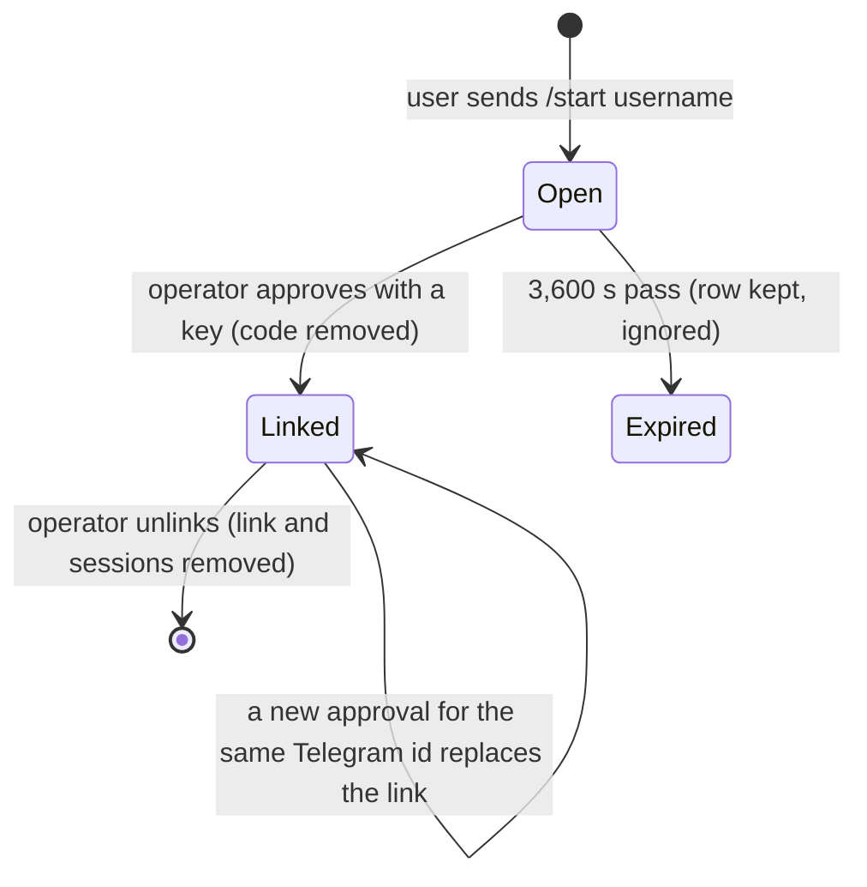

# Data Model: Account Linking

Storage is the bot's own database. Terms follow [`../glossary.md`](../glossary.md).

## Entities

### Link

| Field | Type | Rules |
|---|---|---|
| telegram user id | integer (64-bit) | Primary key. One link per Telegram user. |
| username | text, required | The name the endpoint knows the user by, as given in the pairing request. Not unique. |
| Telegram name | text, required | The user's full name when the code was created. |
| API key (encrypted) | text, required | The endpoint API key, encrypted with the configured key. Never returned by any list. |
| created at | timestamp with time zone | Set when the link is first made; a replacement keeps it. |

Saving a link for an existing Telegram user replaces username, name and key.

### Pairing code

| Field | Type | Rules |
|---|---|---|
| code | text | Primary key. 8 characters from `ABCDEFGHJKLMNPQRSTUVWXYZ23456789`. |
| telegram user id | integer (64-bit) | Indexed. |
| username | text, required | Free text from the request. |
| Telegram name | text, required | The user's full name. |
| chat id | integer (64-bit) | The chat the confirmation is sent to. |
| created at | double precision | Seconds since the Unix epoch. Rules compare against it; there is no expiry column. |

## State transitions

## Relationships

- A Link and the Sessions of the same user are related by the Telegram user id; removing a link removes those sessions (see capability 002).
- A pairing code is independent of a link until approval consumes it.
