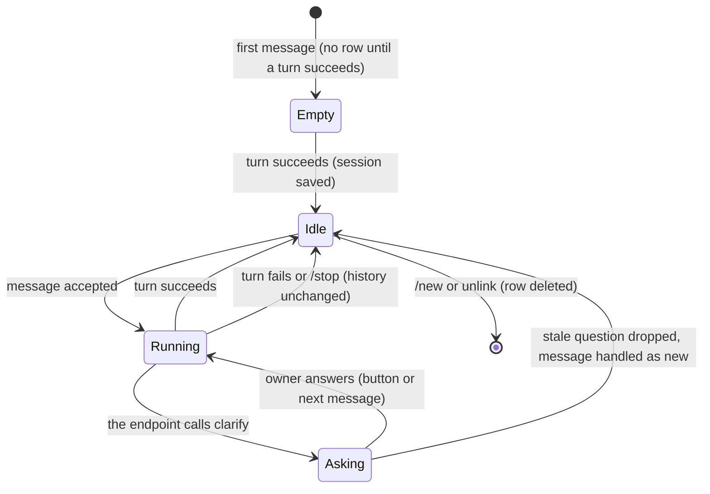

# Data Model: Conversations

Storage is the bot's own database. This file owns the Session and the stored message text; other capabilities refer to them. Terms follow [`../glossary.md`](../glossary.md).

## Entities

### Session

| Field | Type | Rules |
|---|---|---|
| key | text | Primary key. `<chat id>`, then `:<topic id>` when there is a topic, then `:<user id>` when the chat is not private. |
| telegram user id | integer (64-bit) | Indexed. The owner of the session. |
| model | text, optional | The model set by the user; empty means the configured default. |
| params | JSON object | The settings in effect. Keys are the setting names; `reasoning_effort` is one of them. Default `{}`. |
| messages | JSON array | The history in the endpoint's message shape: user messages (text, or a list of text and image parts), assistant messages (text and/or tool calls), tool messages. Default `[]`. |
| pending | JSON object, optional | The open question, if any (below). |
| updated at | timestamp with time zone | Set on every save. |

### Open question (inside a session)

| Field | Type | Rules |
|---|---|---|
| tool call id | text | The id of the assistant's `clarify` call. The history ends with that assistant message. |
| question | text | Shown on the card. |
| options | list of text | The button labels; may be empty. |
| chat id | integer | Where the card was sent. |
| created at | number | Seconds since the Unix epoch; a question older than 86,400 seconds is stale. |
| card message id | integer, optional | Set after the card is sent; the card is found by chat id and this id. |

### Message text

| Field | Type | Rules |
|---|---|---|
| chat id | integer (64-bit) | Part of the primary key. |
| message id | integer (64-bit) | Part of the primary key. |
| text | text | The message text, or the text built from it. Saving the same message again replaces the text. |
| created at | timestamp with time zone | Default now. Never used to delete rows. |

## State transitions

## Relationships

- A Session belongs to one Telegram user; deleting a user's link deletes all their sessions (capability 001).
- A Message text has no relation to a session; it is looked up by chat and message id.
