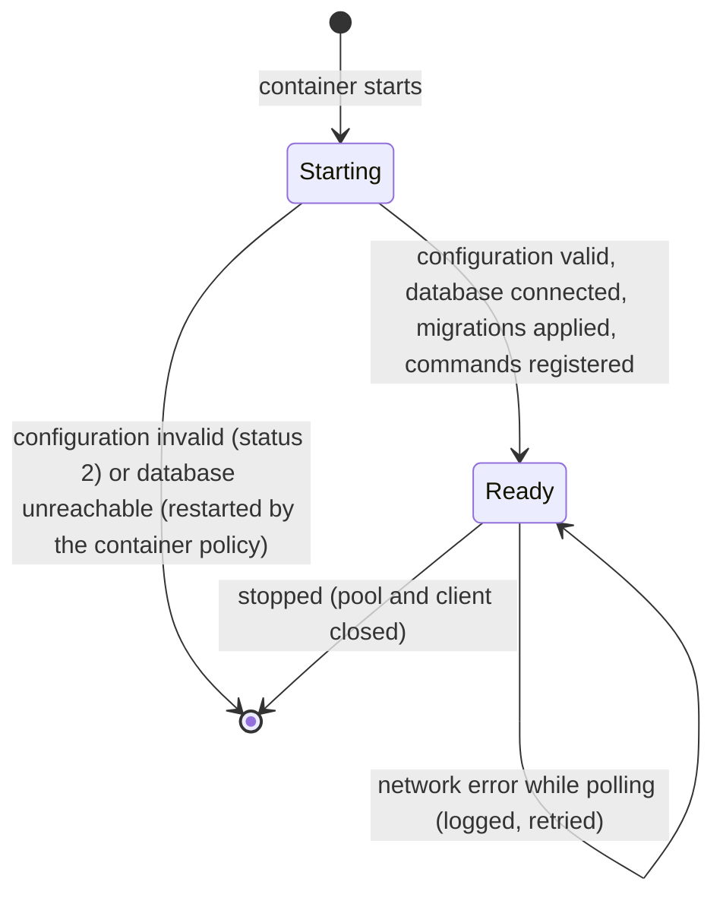

# Data Model: Operations

The schema of the bot's database as created by its migrations. Each entity is described in the capability that owns it: links and pairing codes in `001-account-linking/data-model.md`, sessions and message texts in `002-conversations/data-model.md`.

## Tables

| Table | Owned by | Primary key | Indexes |
|---|---|---|---|
| `links` | 001 | `telegram_user_id` | none besides the key |
| `pairing_codes` | 001 | `code` | `pairing_codes_user` on `telegram_user_id` |
| `sessions` | 002 | `key` | `sessions_user` on `telegram_user_id` |
| `message_texts` | 002 | `chat_id`, `message_id` | none besides the key |
| `schema_migrations` | 006 | `name` | none besides the key |

## Migrations

- Files are named with a number prefix, for example `001_init.sql`, and applied in name order.
- `schema_migrations(name text primary key)` records each file once it is applied.
- Applying takes a database-wide advisory lock (number 7466) so two processes do not apply at the same time; each file is applied and recorded, then committed.

## Database role

The bundled compose file creates the role `telegram_bot` and the database `telegram_bot`, owned by the role, from the PostgreSQL container's settings. Any PostgreSQL role that owns an empty database will do: the bot creates only its own tables, through its migrations, and needs no other rights.

## State of the service

